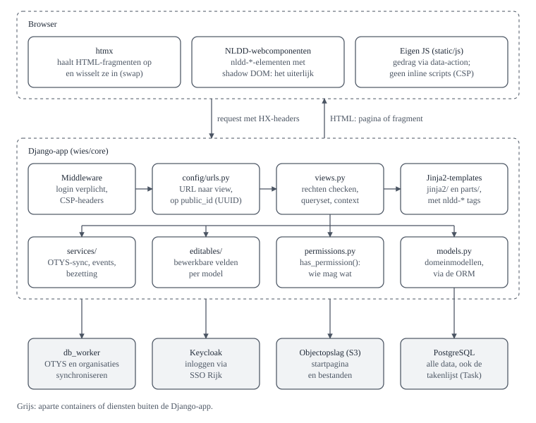
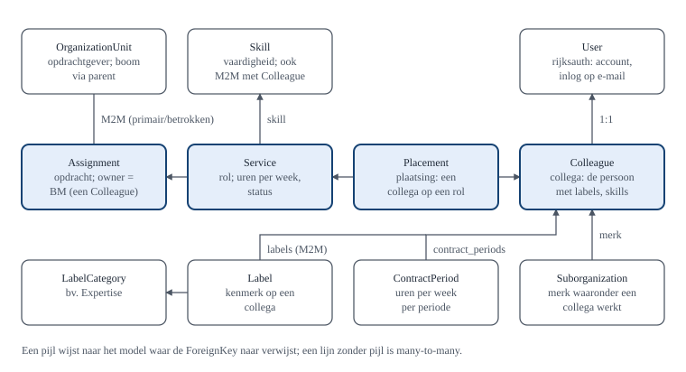

<!--
  Source of truth for this handbook page, also shown in Wies at /handboek/.
  After editing, regenerate the in-product pages:
      uv run python manage.py generate_docs_html
-->

# De code

## Opbouw

Wies is een standaard Django-project. Een request loopt van middleware via `config/urls.py` naar een view, die modellen ophaalt, rechten controleert en een template rendert. Opslaan gaat via een formulier.

| Onderdeel                                | Wat het doet                                | In Wies                                              |
| ---------------------------------------- | ------------------------------------------- | ---------------------------------------------------- |
| [Settings](#waar-staat-wat)              | Instellingen per omgeving                   | `config/settings/`                                   |
| [URL-configuratie](#views)               | URL naar view                               | `config/urls.py`                                     |
| [Middleware](#views)                     | Login en headers bij elk request            | `wies/core/middleware.py`, `config/settings/base.py` |
| [Models](#modellen)                      | Datamodel                                   | `wies/core/models.py`                                |
| [Migraties](#modellen)                   | Schemawijzigingen                           | `wies/core/migrations/`                              |
| [Views](#views)                          | Logica per pagina                           | `wies/core/views.py`                                 |
| [Templates](#templates)                  | HTML, in Jinja2                             | `wies/core/jinja2/`                                  |
| [Forms](#editables)                      | Invoer en validatie                         | `wies/core/forms.py`, `wies/core/editables/`         |
| [Auth en permissies](#rollen-en-rechten) | Inloggen en rechten                         | `wies/rijksauth/`, `wies/core/permissions.py`        |
| [Management commands](#waar-staat-wat)   | Taken voor de command line, zoals dummydata | `wies/core/management/commands/`                     |

Afwijkend: templates zijn Jinja2, en htmx vraagt vaak alleen een fragment op in plaats van de hele pagina.

## Plattegrond

Wies is een server-gerenderde Django-app. De browser vraagt een pagina of een fragment op, Django bouwt de HTML, en htmx zet een fragment op zijn plek zonder de pagina te herladen.



**Browser.** htmx vraagt fragmenten op en zet ze op hun plek, zonder de pagina te herladen. De NLDD-webcomponenten (`nldd-*`) bepalen het uiterlijk. Eigen JavaScript staat in `static/js/` en hangt aan `data-action`-attributen, omdat de Content-Security-Policy inline scripts blokkeert.

**Django-app.** Middleware dwingt inloggen en beveiligingsheaders af. `config/urls.py` stuurt elke URL naar een view in `views.py`. De view controleert met `has_permission` de rechten, haalt gegevens op en rendert een Jinja2-template.

**Onder de views.** `models.py` beschrijft de gegevens, `permissions.py` wie wat mag en `editables/` welke velden bewerkbaar zijn. `services/` bevat logica die niet aan een request hangt, zoals de OTYS-sync en de audit-log.

**Buiten de app.** PostgreSQL bewaart alle data, ook de takenlijst van de worker. Keycloak regelt het inloggen via SSO Rijk. De objectopslag bewaart de startpagina. De `db_worker` draait achtergrondtaken, zoals de sync met OTYS en organisaties.overheid.nl.

## Waar staat wat

Bijna alles zit in `wies/core/`. De meeste wijzigingen raken `views.py` en `models.py`.

| Pad                                                                                   | Wat er staat                                                                                           | Wanneer je er komt                                  |
| ------------------------------------------------------------------------------------- | ------------------------------------------------------------------------------------------------------ | --------------------------------------------------- |
| `wies/core/models.py`                                                                 | Alle domeinmodellen                                                                                    | Elke modelwijziging                                 |
| `wies/core/views.py`                                                                  | Alle views, pagina's én htmx-fragmenten                                                                | Bijna elke feature                                  |
| `wies/core/forms.py`, `form_mixins.py`, `widgets.py`, `fields.py`                     | Formulieren, `NlddFormMixin`, eigen widgets                                                            | Formulieren bouwen                                  |
| `wies/core/editables/`                                                                | Bewerkbare velden per model (`assignment.py`, `colleague.py`, `placement.py`, `service.py`, `user.py`) | Een veld bewerkbaar maken                           |
| `wies/core/inline_edit/`                                                              | Het mechaniek achter inline bewerken                                                                   | Zelden; alleen als het systeem zelf moet veranderen |
| `wies/core/permissions.py`, `permission_engine.py`, `roles.py`, `visibility_rules.py` | Rechten, rollen, zichtbaarheid                                                                         | Wie mag wat                                         |
| `wies/core/querysets.py`                                                              | Herbruikbare annotaties (datums, sorteernamen, tellingen)                                              | Lijsten en filters                                  |
| `wies/core/public_id.py`                                                              | UUID's in URL's, `FacetResolver` voor filters                                                          | Nieuwe URL of filter                                |
| `wies/core/services/`                                                                 | Domeinlogica buiten de views: OTYS-sync, events, bezetting, rollenmatrix, gebruikers                   | Logica die niet in een view hoort                   |
| `wies/core/jinja2/`                                                                   | Pagina's (bovenste niveau), fragmenten (`parts/`), formulierweergave (`forms/`)                        | Elke UI-wijziging                                   |
| `wies/core/static/js/`, `static/css/`                                                 | Eigen JavaScript en CSS                                                                                | Gedrag of styling                                   |
| `wies/core/management/commands/`                                                      | `setup`, `load_dummy_data`, `sync_organizations`, `db_worker` en meer                                  | Dummydata, taken                                    |
| `wies/core/tests/`                                                                    | 74 testbestanden, één per feature                                                                      | Altijd                                              |
| `wies/core/monitoring/`                                                               | `ErrorReportingHandler`: 500's naar `ErrorEvent` en Mattermost                                         | Foutmeldingen                                       |
| `wies/rijksauth/`                                                                     | Eigen `User`-model, OIDC-login via Keycloak, eigen README                                              | Inloggen                                            |
| `wies/startpage/`                                                                     | De ODI-startpagina: een Hugo-site uit de objectopslag                                                  | Startpagina                                         |
| `config/settings/`                                                                    | `base`, `local`, `test`, `production`, `worker`                                                        | Instellingen                                        |
| `config/jinja2.py`                                                                    | Globals en filters voor templates (`datum_nl`, `url`, `inline_edit`, ...)                              | Een template-helper zoeken                          |
| `features/`                                                                           | Ontwerpdocumenten: `inline-editing.md`, `public_id.md`                                                 | Vóór je aan die systemen komt                       |
| `docs/`                                                                               | `roles.md`, `privacy.md`, `beheer.md`                                                                  | Achtergrond                                         |
| `PDR/`                                                                                | Besluitvorming (product decision records)                                                              | Waarom iets zo is                                   |
| `CHANGES.md`                                                                          | Changelog                                                                                              | Elke PR                                             |
| `.claude/`                                                                            | Projectregels voor Claude Code; de `rules/` zijn ook voor mensen goed leesvoer                         | Bij twijfel over een conventie                      |

`config/urls.py` koppelt elke URL aan een view in `views.py`.

## Modellen

Alle domeinmodellen staan in `wies/core/models.py`, het account in `wies/rijksauth/models.py`. De kern is de keten uit [Wies in het kort](aan-de-slag.md#wies-in-het-kort); de rest hangt aan een collega of een opdracht.



Zo hangen de modellen aan elkaar; een ForeignKey is steeds een verwijzing naar precies één ander record:

| Relatie                                                            | In de code                                                                 |
| ------------------------------------------------------------------ | -------------------------------------------------------------------------- |
| Een rol hoort bij één opdracht                                     | `Service.assignment` (ForeignKey)                                          |
| Een plaatsing zet één collega op één rol                           | `Placement.service`, `Placement.colleague` (ForeignKeys)                   |
| Een opdracht heeft één of meer opdrachtgevers, waarvan één primair | `Assignment.organizations` (many-to-many via `AssignmentOrganizationUnit`) |
| Een opdracht heeft één business manager                            | `Assignment.owner` (ForeignKey naar `Colleague`)                           |
| Een rol vraagt één vaardigheid                                     | `Service.skill` (ForeignKey)                                               |
| Een collega kan een account hebben                                 | `Colleague.user` (one-to-one)                                              |
| Een collega heeft labels en vaardigheden                           | `Colleague.labels`, `Colleague.skills` (many-to-many)                      |
| Een collega werkt onder één merk                                   | `Colleague.suborganization` (ForeignKey)                                   |
| Een collega heeft contractperiodes                                 | `ContractPeriod.colleague` (ForeignKey)                                    |
| Een label hoort bij één categorie                                  | `Label.category` (ForeignKey)                                              |
| Een organisatie valt onder een bovenliggende organisatie           | `OrganizationUnit.parent` (ForeignKey)                                     |

Niet in de tabel, maar wel goed om te weten:

- `AssignmentOrganizationUnit` is de koppeltabel tussen opdracht en opdrachtgever, met een `role` (primair of betrokken). Elke opdracht heeft precies één primaire opdrachtgever.
- `Event` is de audit-log. `object_id` is een gewoon getal, geen ForeignKey, zodat de geschiedenis een verwijdering overleeft. Schrijf events met `create_event()` uit `services/events.py`.
- `ErrorEvent` bewaart 500-fouten, `Task` de achtergrondtaken voor de worker.
- Verwijderen is echt verwijderen; er zijn geen soft deletes. Een collega verwijderen neemt zijn plaatsingen mee (`CASCADE`); een opdrachtgever die nog gebruikt wordt kun je niet verwijderen (`PROTECT`).

### Opdrachtgevers komen uit organisaties.overheid.nl

Wies maakt geen eigen lijst van overheidsorganisaties. Een periodieke sync haalt de structuur op van [organisaties.overheid.nl](https://organisaties.overheid.nl) en slaat die op als boom (`OrganizationUnit.parent`). Een organisatie die daar verdwijnt, krijgt een einddatum. Is er nooit een opdracht aan gekoppeld geweest, dan wordt ze verwijderd. Ontbreekt een organisatie? Die vraag je aan bij organisaties.overheid.nl, niet in Wies.

Een opdracht heeft precies één primaire opdrachtgever en kan daarnaast betrokken opdrachtgevers hebben. Een voorbeeld: een ministerie is opdrachtgever en een uitvoeringsorganisatie is betrokken.

### Periodes erven van boven

Een rol heeft standaard de periode van zijn opdracht, en een plaatsing de periode van zijn rol. Pas als `period_source` op de eigen waarde staat, gelden de eigen datums (`specific_start_date`, `specific_end_date`). Lees die velden dus nooit direct: gebruik de properties `start_date` en `end_date`, of in lijsten `annotate_placement_dates()` uit `querysets.py`.

### public_id: nooit het id in een URL

Het integer-id is opeenvolgend: wie het in een URL ziet, kan alle records aftellen. Elk model dat ooit in een URL, filter of verborgen formulierveld komt, krijgt daarom een `public_id`:

```python
public_id = models.UUIDField(default=uuid.uuid4, unique=True, editable=False)
```

- Route op `<uuid:public_id>` en zoek het object op met `public_id`. Een ongeldige waarde geeft dan al een 404 voordat de database wordt geraakt.
- Filters in lijsten (`?org=...`) lopen via `FacetResolver` uit `wies/core/public_id.py`. Die **faalt dicht**: een filterwaarde die niets oplevert, geeft een lege lijst, nooit een ongefilterde.
- Een `public_id` is geen autorisatie. Rechten controleer je altijd apart.

De migratie gaat in **drie stappen**: veld nullable toevoegen, elke rij een eigen UUID geven, dan unique en verplicht maken. Eén `AddField` met een default geeft alle bestaande rijen dezelfde waarde. Voorbeeld: `wies/core/migrations/0012_public_ids.py`. Volledige uitleg in `features/public_id.md`.

## Views

`wies/core/views.py` is met bijna 5.000 regels veruit het grootste bestand van Wies. Het is één platte module met vooral functies. Alleen de drie lijstpagina's zijn klassen: `ListView`s met `PublicIdFacetsMixin` voor de filters. Domeinlogica die niet aan een request hangt, hoort in `wies/core/services/`, niet in de view.

### Wat er staat, van boven naar beneden

| Deel                          | Waarvoor                                                  | Namen om op te zoeken                                                                                                          |
| ----------------------------- | --------------------------------------------------------- | ------------------------------------------------------------------------------------------------------------------------------ |
| Paneel-helpers                | URL's en data voor de zijpanelen                          | `PANEL_PARAMS`, `_build_panel_url`, `_resolve_panel_object`, `_build_assignment_panel_data` en de andere `_build_*_panel_data` |
| Business management en beheer | Bezetting, rollenmatrix, statistieken, foutmeldingen      | `bezetting`, `role_matrix`, `staff_dashboard`, `error_table`                                                                   |
| Lijstpagina's                 | Wie zit waar?, opdrachten, gebruikers                     | `PlacementListView`, `AssignmentListView`, `UserListView`                                                                      |
| Beheerpagina's                | Gebruikers, CSV-import, labels, merken, contracturen      | `user_create`, `user_import_csv`, `label_admin`, `suborganization_admin`, `contract_period_add`                                |
| Opdrachthistorie              | De tijdlijn met wijzigingen, en verwijderen               | `assignment_events_partial`, `assignment_delete`                                                                               |
| Profiel en onboarding         | Je eigen profiel en de wizard bij de eerste keer inloggen | `user_profile`, `onboarding_assignment_edit`                                                                                   |
| Footerpagina's en fouten      | FAQ, handleiding, dit handboek, 404 en 500                | `handleiding`, `handboek`, `error_404`                                                                                         |
| Zoeken en filters             | Zoeksuggesties, opdrachtgever-kiezer                      | `search_suggestions`, `client_modal`                                                                                           |
| Inline-edit-engine            | Het potlood                                               | `inline_edit_view`                                                                                                             |
| Bewerk-sheets                 | Opslaan vanuit een zijpaneel                              | `assignment_edit_view`, `placement_edit_view`, `assignment_member_edit_view`, `assignment_create_sheet`                        |

### Patronen die je overal tegenkomt

- **Inloggen is standaard verplicht.** `LoginRequiredMiddleware` beschermt elke view. Een openbare view krijgt bewust `@login_not_required`.
- **Rechten zitten op twee niveaus.** Hele pagina's met `@permission_required(..., raise_exception=True)` of de decorators uit `roles.py`; objecten en velden met `has_permission()` in de view zelf. Zie [Rollen en rechten](#rollen-en-rechten).
- **Een object zoek je op `public_id`**, nooit op het integer-id. De inline-edit-engine geeft bovendien hetzelfde antwoord op een object dat niet bestaat als op een object dat je niet mag zien, zodat je niet kunt raden welke id's bestaan.
- **Eén view, twee soorten antwoord.** Zonder htmx rendert een view de hele pagina; met de header `HX-Request` alleen het fragment. In de lijstviews beslist `get_template_names()` dat, op basis van `HX-Target` en de queryparameters.
- **Het zijpaneel hangt aan de URL.** Parameters als `?opdracht=<uuid>`, `&bewerken=1` en `&teamlid=…` (`PANEL_PARAMS`) bepalen welk paneel openstaat. Daarom werken een gedeelde link en de terugknop gewoon.
- **Schrijven gaat alleen via POST** (`@require_POST`), in een `transaction.atomic()`. Na opslaan stuurt de view htmx verder met een header als `HX-Location`, `HX-Redirect` of `HX-Trigger`, in plaats van zelf HTML terug te geven.
- **Een terug-URL uit het formulier vertrouw je niet zomaar.** `_safe_return_path()` laat alleen paden binnen Wies door.
- **Lokale imports binnen een functie** voorkomen circulaire imports met de Editables. Zie je er een met `# noqa: PLC0415`, dan is dat de reden.

### Een view toevoegen

1. Schrijf de functie in `views.py`, bij de views die erop lijken.
2. Voeg een route toe in `config/urls.py`. Gaat het over één object, gebruik dan `<uuid:public_id>`.
3. Bepaal wie erbij mag: een decorator voor de hele pagina, `has_permission()` voor het object.
4. Maak een pagina-template in `wies/core/jinja2/` en, als htmx alleen een stuk vervangt, een fragment in `parts/`.
5. Zet de logica die niet over het request gaat in `wies/core/services/`.
6. Test de view voor elke rol: één die mag en één die niet mag.

## Templates

De server rendert alle HTML. htmx haalt fragmenten op en zet ze op hun plek, en de NLDD-webcomponenten zorgen voor het uiterlijk. Er is geen frontend-framework en geen build-stap voor eigen code.

### Templates

- **Pagina's** staan bovenaan in `wies/core/jinja2/` (`placements.html`, `assignments.html`, `bezetting.html`, ...) en erven van `base.html`. Die heeft de blokken `title`, `extra_head`, `header`, `sidebar`, `content` en `panel`.
- **Fragmenten** voor htmx staan in `parts/`: zijpanelen (`*_panel_content.html`), sheets en modals (`*_sheet.html`, `*_modal.html`), rijen, filterchips.
- **Formulieren** worden gerenderd via `forms/` (`field.html`, `widgets/`, `displays/` voor de alleen-lezenweergave van inline velden).
- Het is **Jinja2, niet Django-templates**. Je hebt dus geen `` en geen Django-tags. Wat beschikbaar is, staat in `config/jinja2.py`: onder meer `url()`, `static()`, `nldd_asset()`, `app_asset()`, `inline_edit()`, `wire_field_errors()` en filters als `datum_nl` ("11 nov 2024") en `tijdgeleden`.

### NLDD-webcomponenten

Alle UI bouw je met `nldd-*`-elementen uit het [NLDD-designsysteem](https://design.digitaledienst.overheid.nl/), het npm-pakket [@nldd/design-system](https://www.npmjs.com/package/@nldd/design-system). Componenten, attributen en icoonnamen zoek je op in de [storybook](https://minbzk.github.io/storybook/) of in `node_modules/@nldd/design-system/custom-elements.json`. Raad geen namen: een onbekend icoon rendert stil niets, een onbekende `appearance` valt stil terug op de standaard.

NLDD en htmx worden niet ingecheckt. `just vendor` kopieert ze uit `package-lock.json` naar `wies/core/static/vendor/`. Dependabot stelt upgrades voor; lees bij een NLDD-upgrade altijd de breaking changes, want die breken vaak stil.

### Geen inline JavaScript

De Content-Security-Policy is `script-src 'self'` (ingesteld in `wies/core/middleware.py`). Elk `<script>`-blok, elke `onclick=` en elke `hx-on` in een template wordt door de browser **stil** geblokkeerd: de knop doet gewoon niets.

Zo bind je wel gedrag:

1. Zet een data-attribuut op het element: `data-action="<naam>"`, `data-confirm="<vraag>"` of `data-keyboard-activate`.
2. Handel het af in `wies/core/static/js/ui_handlers.js`; voor een klik voeg je een entry toe aan `CLICK_ACTIONS`.
3. Nieuw gedrag dat niet in `ui_handlers.js` past, krijgt een eigen bestand in `static/js/`, geladen via `app_asset()` in `base.html`.

Gebruik nooit een styling-class als haakje voor gedrag; een CSS-hernoeming sloopt dan stil de binding. `test_templates_no_inline_js.py` bewaakt dit en laat de build falen.

### JavaScript-bestanden die je gaat tegenkomen

| Bestand                              | Waarvoor                                                                       |
| ------------------------------------ | ------------------------------------------------------------------------------ |
| `ui_handlers.js`                     | Centrale afhandeling van `data-action`, `data-confirm` en toetsenbordactivatie |
| `dialog.js`                          | Opent sheets en modals met `data-auto-show` na een htmx-swap                   |
| `side_panel.js`                      | De stapel zijpanelen, met URL-synchronisatie en de terugknop van de browser    |
| `hx_link_guard.js`                   | Voorkomt dat een `nldd-*`-element met `href` én `hx-get` wegnavigeert          |
| `menu_nav.js`                        | Uitloggen als POST vanuit een menu in een shadow root                          |
| `focus_restore.js`, `live_region.js` | Toegankelijkheid na een swap: focus op een logische plek, wijziging voorlezen  |
| `htmx_config.js`                     | Globale htmx-instellingen                                                      |

Pure functies in deze bestanden hebben tests in `js_tests/` (`node --test`).

### Eigen CSS

`static/css/app.css` bevat de weinige eigen regels. Een regel die een `nldd-*`-element stylt, krijgt een comment erboven dat uitlegt waarom het component het zelf niet kan. Lukt die zin niet, dan hoort de regel er niet. Test elke stylingwijziging in licht én donker: een niet-bestaand token valt terug op zijn fallback en dat zie je pas in dark mode.

## Editables

Een bewerkbaar veld beschrijf je één keer, als `Editable`. Elk formulier in Wies gebruikt die beschrijving, dus label, invoerveld, validatie en rechten zijn overal gelijk. In de code heet het mechaniek nog _inline editing_ (`wies/core/inline_edit/`), naar het potloodje waarmee het begon.

### Een veld beschrijven

Uit `wies/core/editables/assignment.py`:

```python
class AssignmentEditables(EditableSet):
    class Meta:
        model = Assignment

    name = Editable(label="Opdrachtnaam")
    extra_info = Editable(
        label="Opdrachtomschrijving",
        widget=forms.Textarea(attrs={"rows": 2}),
    )
```

Van een opdracht zijn de naam en de omschrijving bewerkbaar, met dit label en dit invoerveld. Of een veld verplicht is en hoe lang het mag zijn, komt uit het model. Wie het mag bewerken, staat apart in `permissions.py`.

| Begrip          | Wat het is                                                             |
| --------------- | ---------------------------------------------------------------------- |
| `Editable`      | Eén bewerkbaar veld                                                    |
| `EditableGroup` | Velden die je samen bewerkt, zoals een periode met start- en einddatum |
| `EditableSet`   | Alle bewerkbare velden van één model, zoals `AssignmentEditables`      |

Sets bestaan voor Assignment, Colleague, Placement, Service en User. Een nieuw veld op zo'n model hoort hier, niet als los formulierveld.

### Waar de beschrijving gebruikt wordt

- **Gegevens wijzigen in het zijpaneel.** `assignment_edit_specs()` in `services/assignments.py` pakt de velden die jij mag bewerken; `build_combined_form_class()` maakt er één formulier van.
- **Een nieuwe opdracht.** Zelfde aanpak, via `assignment_create_specs()`.
- **Het potloodje.** `{{ inline_edit(obj, "name") }}` toont een waarde met een potlood; klikken wisselt naar een klein formulier. In de zijpanelen is dit vervangen door het bewerk-sheet; je ziet het nog in de onboarding.

### Wat er bij opslaan gebeurt

- Het object wordt opgezocht op `public_id`. Een object dat niet bestaat en een object waar je niet bij mag, krijgen precies hetzelfde antwoord. Zo kun je niet raden welke id's bestaan.
- Een verborgen `_concurrency_token` en `select_for_update()` voorkomen dat twee mensen elkaars wijziging overschrijven. Bij een conflict krijg je het formulier terug met een waarschuwing.
- `save_edit_specs()` in `services/inline_edit_save.py` slaat op en schrijft een audit-event. Dat gebeurt alleen voor sets met `audit_events = True` (Assignment en User); een plaatsingswijziging komt via `audit_mirror` als "Team"-event op de opdracht.

### Zo voeg je een bewerkbaar veld toe

1. Voeg het veld toe aan het model, met migratie (zie [Zo werken we](samenwerken.md#zo-werken-we)).
2. Declareer `foo = Editable(label="...")` op de `EditableSet` in `wies/core/editables/<model>.py`. Querysets voor keuzes geef je als callable mee, niet als queryset.
3. Moet een andere groep dit veld mogen bewerken dan het hele object? Voeg een regel toe in `permissions.py`: `rule(UPDATE, XEditables.foo, label=..., grants=[Grant(...)])`. Zonder regel geldt de regel van het model.
4. Heeft het veld een bijzondere weergave nodig? Maak een partial in `jinja2/forms/displays/`.
5. Toon het: `{{ inline_edit(obj, "foo") }}`, of voeg het toe aan `assignment_edit_specs()` en het sheet-template.
6. Test het met `post_inline_edit()` uit `tests/inline_edit_helpers.py`. Die doet eerst een GET om het concurrency-token op te halen; een kale POST faalt.

Achtergrond: `features/inline-editing.md`. Let op: dat document loopt op een paar punten achter. `AssignmentCreateForm` en `RvoFormMixin` bestaan niet meer, en de weergaves staan in `jinja2/forms/displays/`, niet in `rvo/`.

## Rollen en rechten

Rechten worden gecontroleerd op drie niveaus: de pagina, het object en het veld. De regels staan op één plek, `wies/core/permissions.py`, en de rollenmatrix op `/beheer/rollen/` wordt daar direct uit opgebouwd. Achtergrond: `docs/roles.md`.

### De rollen

Een rol wordt opgeslagen onder een **sleutel** (`Group.name`); wat je op het scherm ziet is een label (`role_label()` in `roles.py`). Match in code altijd op de sleutel. De Applicatiebeheerder is geen groep: wie die rol heeft, staat in de omgevingsvariabele `STAFF_EMAILS`. Wat elke rol mag, staat in de matrix hieronder.

| Rol                 | Sleutel            | Staat in       |
| ------------------- | ------------------ | -------------- |
| Gebruikersbeheerder | `user_admin`       | Django-groep   |
| Business Manager    | `business_manager` | Django-groep   |
| Consultant          | `consultant`       | Django-groep   |
| Applicatiebeheerder | `staff`            | `STAFF_EMAILS` |

Daarnaast zijn er rechten die je krijgt door je **relatie** met een object, niet door een rol. Iedereen mag zijn eigen profiel bewerken (`SELF`). Wie op een opdracht geplaatst is, mag de naam en de extra informatie ervan bewerken (`PLACED`), en de taken van de eigen rol (`PLACED_ON_SERVICE`).

### Wat elke rol mag

Dit is dezelfde matrix als op `/beheer/rollen/` in de app, gegenereerd met `build_matrix()` uit `wies/core/services/role_matrix.py`. Heb je meer rollen, dan mag je alles wat in die kolommen staat. "Ongeacht je rol" betekent dat het over jezelf gaat, over je eigen gegevens of over een opdracht waarop je geplaatst bent. De pagina in de app wordt live uit de regels gebouwd en wint als deze tabel achterloopt.

### Wat elke rol mag: opdrachten

Bewerken kan alleen bij opdrachten uit Wies, niet bij opdrachten uit OTYS.

| Handeling                                                                  | Consultant | Business Manager | Gebruikersbeheerder | Applicatiebeheerder |
| -------------------------------------------------------------------------- | ---------- | ---------------- | ------------------- | ------------------- |
| Opdracht wijzigen                                                          | –          | Ja               | –                   | –                   |
| Teamlid wijzigen                                                           | –          | Ja               | –                   | –                   |
| Plaatsing wijzigen                                                         | –          | Ja               | –                   | –                   |
| Opdracht verwijderen                                                       | –          | Ja               | –                   | –                   |
| Naam van een opdracht wijzigen (waarop je geplaatst bent, ongeacht je rol) | Ja         | Ja               | Ja                  | Ja                  |
| Naam van een opdracht wijzigen (van een ander)                             | –          | Ja               | –                   | –                   |
| Opdrachtomschrijving wijzigen (waarop je geplaatst bent, ongeacht je rol)  | Ja         | Ja               | Ja                  | Ja                  |
| Opdrachtomschrijving wijzigen (van een ander)                              | –          | Ja               | –                   | –                   |
| Taken wijzigen (je eigen plaatsing, ongeacht je rol)                       | Ja         | Ja               | Ja                  | Ja                  |
| Taken wijzigen (van een ander)                                             | –          | Ja               | –                   | –                   |

### Wat elke rol mag: zichtbaarheid

| Handeling                                                       | Consultant | Business Manager | Gebruikersbeheerder | Applicatiebeheerder |
| --------------------------------------------------------------- | ---------- | ---------------- | ------------------- | ------------------- |
| Eigen afgelopen plaatsing zien (ongeacht je rol)                | Ja         | Ja               | Ja                  | Ja                  |
| Afgelopen plaatsing van een collega zien                        | –          | Ja               | –                   | –                   |
| Afgelopen opdracht op het profiel van een Business Manager zien | –          | Ja               | –                   | –                   |
| Business management openen                                      | –          | Ja               | –                   | –                   |
| Uren per week van een geplaatste collega zien                   | –          | Ja               | –                   | –                   |

### Wat elke rol mag: gebruikers en collega's

| Handeling                                       | Consultant | Business Manager | Gebruikersbeheerder | Applicatiebeheerder |
| ----------------------------------------------- | ---------- | ---------------- | ------------------- | ------------------- |
| Collega wijzigen (je eigen, ongeacht je rol)    | Ja         | Ja               | Ja                  | Ja                  |
| Collega wijzigen (van een ander)                | –          | –                | Ja                  | –                   |
| Gebruiker wijzigen (je eigen, ongeacht je rol)  | Ja         | Ja               | Ja                  | Ja                  |
| Gebruiker wijzigen (van een ander)              | –          | –                | Ja                  | –                   |
| Contracturen van een collega zien               | –          | Ja               | Ja                  | –                   |
| Contracturen van een collega bijhouden          | –          | –                | Ja                  | –                   |
| E-mailadres wijzigen met het potlood            | –          | –                | –                   | –                   |
| Gebruikers, labels, merken en rollen openen     | –          | –                | Ja                  | –                   |
| Gebruiker toevoegen en verwijderen              | –          | –                | Ja                  | –                   |
| E-mailadres wijzigen in het gebruikersformulier | –          | –                | Ja                  | –                   |
| Rollen toekennen                                | –          | –                | Ja                  | –                   |

### Wat elke rol mag: applicatie

| Handeling                     | Consultant | Business Manager | Gebruikersbeheerder | Applicatiebeheerder |
| ----------------------------- | ---------- | ---------------- | ------------------- | ------------------- |
| Statistieken en database zien | –          | –                | –                   | Ja                  |

Twee rijen vallen op. "E-mailadres wijzigen met het potlood" mag niemand: die regel heeft bewust geen grants, het e-mailadres verandert alleen via het gebruikersformulier. En de Applicatiebeheerder heeft geen functionele rechten; wie ook opdrachten moet bewerken, heeft daarnaast de rol Business Manager nodig.

Voeg je een regel toe in `permissions.py`, dan verschijnt hij vanzelf als rij in de matrix in de app. `test_role_matrix.py` bewaakt dat de pagina en de regels gelijk blijven. Deze tabel in de cursus moet je wel zelf bijwerken.

### Waar je het in de code tegenkomt

| Niveau                  | Hoe                                                                                                                                                                                                  | Waar                                            |
| ----------------------- | ---------------------------------------------------------------------------------------------------------------------------------------------------------------------------------------------------- | ----------------------------------------------- |
| Hele sectie             | Decorators `staff_required`, `business_management_access_required`, `user_admin_required`; sturen door naar `/geen-toegang/`                                                                         | `roles.py`                                      |
| Lijst- en aanmaakpagina | Django-permissies: `@permission_required("core.change_label", raise_exception=True)` of `PermissionRequiredMixin`                                                                                    | `views.py`                                      |
| Object en veld          | `has_permission(verb, obj, user, field=None)`                                                                                                                                                        | `permission_engine.py`                          |
| Regels zelf             | `rule(verb, target, grants=[Grant(holder, scope)], requires=...)`, met holders `Role(...)` en `Anyone()`, scopes `OWN`, `SELF`, `PLACED`, `PLACED_ON_SERVICE`, `ANY` en de voorwaarde `WIES_SOURCED` | `permissions.py`                                |
| Wat iemand mag zien     | `evaluate_placement_visibility()`, `evaluate_assignment_visibility()`; in lijsten `filter_visible_placements()`                                                                                      | `visibility_rules.py`, `services/placements.py` |
| Menu en navigatie       | Template-vlaggen `show_bm_page`, `show_user_admin_pages`, `show_staff_pages`                                                                                                                         | `visibility_rules.py`                           |

`has_permission` zoekt eerst een regel voor het specifieke veld, daarna voor het model. Een anonieme gebruiker krijgt altijd `False`.

### Zichtbaarheid is iets anders dan bewerken

Een lopende plaatsing is voor iedereen zichtbaar. Een beëindigde of toekomstige plaatsing ziet alleen de collega zelf of een business manager. Die controle gebeurt grotendeels per rij in Python, niet in de queryset. Bouw je een nieuwe lijst, gebruik dan de bestaande functies in plaats van zelf te filteren.

### Drie dingen die je anders op de harde manier leert

- `permissions.py` wordt nergens geïmporteerd om iets te gebruiken. Het vult een register zodra `CoreConfig.ready()` in `apps.py` het importeert. Een regel die je elders definieert, bestaat dus niet.
- Op `STAFF_EMAILS` staan geeft geen functionele rechten. Een applicatiebeheerder die ook opdrachten moet bewerken, heeft daarnaast de rol Business Manager nodig.
- Heeft de laatste gebruikersbeheerder zijn eigen rol afgepakt? Zet `INITIAL_USER_EMAIL`: `ensure_initial_user` geeft dat account bij elke start alle rollen. Haal de variabele daarna weer weg.

## Een request

Dezelfde view levert een hele pagina of alleen een fragment, afhankelijk van de htmx-headers. Volg één voorbeeld: je opent een opdracht in het zijpaneel en wijzigt de gegevens.

### Openen

1. Een kaart in `parts/assignment_card_rows.html` heeft `hx-get="{{ assignment.panel_url }}"` en `hx-target="#side-panel-content"`. De kaart heeft ook een href, zodat ctrl-klik een nieuw tabblad opent; hx_link_guard.js voorkomt dat een gewone klik wegnavigeert. De URL is de lijst-URL met `?opdracht=<uuid>`.
2. `LoginRequiredMiddleware` controleert of je bent ingelogd; elke view is standaard afgeschermd. Opt-out kan alleen met `@login_not_required`.
3. `config/urls.py` stuurt `/opdrachten/` naar `AssignmentListView` in `views.py`.
4. `get_context_data` leest de paneel-parameters (`PANEL_PARAMS`: `collega`, `opdracht`, `aanvraag`, `bewerken`, `teamlid`, ...) en zoekt het object op met `_resolve_panel_object()`, op `public_id`.
5. `_build_assignment_panel_data()` bepaalt onder meer `user_can_edit`, via `has_permission`.
6. `get_template_names` ziet de header `HX-Target: side-panel-content` en rendert alleen `parts/assignment_panel_content.html`. htmx zet dat in het paneel.

Zonder htmx, bijvoorbeeld als je de URL met `?opdracht=` direct opent, rendert dezelfde view de hele pagina met het paneel al open. Zo werken links en de terugknop gewoon.

### Wijzigen

7. De knop "Gegevens wijzigen" doet een `hx-get` naar dezelfde URL met `&bewerken=1`. Nu wordt `parts/assignment_edit_panel_content.html` gerenderd, met een formulier uit `build_combined_form_class()`: alleen de velden die jij mag bewerken.
8. Opslaan doet een `hx-post` naar `/opdracht/<uuid>/bewerken/` (`assignment_edit_view`, `@require_POST`). Mag je geen enkel veld bewerken, dan volgt `403`.
9. Ongeldig? Het sheet komt terug met de fouten erin, gekoppeld via `wire_field_errors`.
10. Geldig? In `transaction.atomic()` slaat `save_edit_specs()` op en schrijft het audit-event. Het antwoord is een `204` met de header `HX-Location`; htmx haalt dan het gewone paneel opnieuw op, met een succesmelding.

### Welke response bij welke request

Er is geen `django-htmx`; views lezen de headers zelf.

| Request                                          | Response                                                   |
| ------------------------------------------------ | ---------------------------------------------------------- |
| Gewone browser-request                           | Hele pagina (`placements.html`, `assignments.html`, ...)   |
| `HX-Request` met `HX-Target: side-panel-content` | Alleen de paneelinhoud                                     |
| `HX-Request` met `?pagina=`                      | Alleen de volgende kaarten                                 |
| `HX-Request` zonder bijzonder doel               | Filters en tabel (`parts/filter_and_table_container.html`) |

Responses sturen htmx bij met `HX-Redirect`, `HX-Location`, `HX-Retarget` en `HX-Trigger`. Een voorbeeld van dat laatste: na een inline edit start `HX-Trigger-After-Swap: inline-edit-saved` de bevestigingsmelding.
